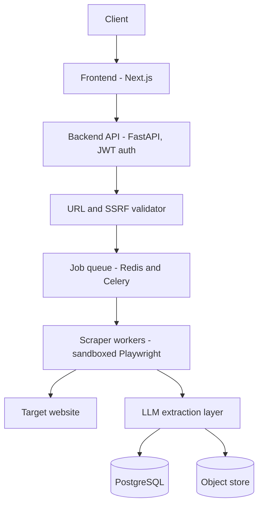

# Smart Web Scraper

Turn any webpage into structured JSON. Give it a URL and the fields you want, and it renders the page, extracts what matters using an LLM, and returns validated JSON.

## Problem statement

Design and build a production-grade, hosted full-stack AI web scraper that uses LLM-based extraction and tool calling to convert any website into structured JSON, secured with SSRF guardrails, rate limiting, and monitoring.

## How it works

1. Submit a URL and a schema, telling it what fields you want back.
2. The backend validates the URL and blocks private or internal targets.
3. A sandboxed worker renders the page, including JavaScript-rendered content.
4. An LLM extracts the requested fields, nothing more.
5. Structured JSON comes back, validated against the schema.



## Tech stack

| Layer | Choice |
|---|---|
| Frontend | Next.js, TypeScript, Tailwind CSS |
| Backend | FastAPI |
| Job queue | Redis + Celery |
| Scraper workers | Playwright, sandboxed in Docker |
| Database | PostgreSQL |
| Object storage | Raw HTML snapshots + JSON output |
| LLM | Claude / GPT, with tool calling for multi-step extraction |
| Monitoring | Prometheus + Grafana, Sentry |
| CI/CD | GitHub Actions |

## Project structure

```
smart-web-scraper/
├── frontend/                  Next.js app
│   ├── app/
│   │   ├── layout.tsx
│   │   ├── page.tsx           Landing page
│   │   ├── status/page.tsx    Live API + database status page
│   │   └── globals.css        Tailwind v4 theme (@theme block)
│   ├── lib/api.ts             Typed client for the FastAPI backend
│   └── .env.example           NEXT_PUBLIC_API_URL template
├── backend/                   FastAPI service
│   ├── app/
│   │   ├── main.py            App entrypoint, CORS, routers
│   │   ├── api/health.py      /health and /health/db
│   │   ├── core/config.py     Settings from environment variables
│   │   └── db/session.py      SQLAlchemy engine and session dependency
│   ├── tests/                 pytest suite
│   ├── requirements.txt
│   ├── requirements-dev.txt
│   └── .env.example           DATABASE_URL and CORS_ORIGINS template
├── docker-compose.yml         Local PostgreSQL 16
└── README.md
```

## Getting started

Prerequisites: Node.js 18+, Python 3.12+, Docker Desktop.

```bash
git clone https://github.com/rahulrvu-24/smart-web-scraper.git
cd smart-web-scraper
```

**1. Database** (from the repo root)

```bash
docker compose up -d postgres
docker compose ps        # wait until STATUS shows (healthy)
```

**2. Backend** (in `backend/`)

```bash
cd backend
python -m venv .venv
.venv\Scripts\activate             # macOS/Linux: source .venv/bin/activate
pip install -r requirements-dev.txt
cp .env.example .env               # Windows PowerShell: Copy-Item .env.example .env
uvicorn app.main:app --reload --port 8000
```

API docs: `http://localhost:8000/docs`. Run tests with `pytest`.

**3. Frontend** (in `frontend/`, in a second terminal)

```bash
cd frontend
npm install
cp .env.example .env.local         # Windows PowerShell: Copy-Item .env.example .env.local
npm run dev
```

Visit `http://localhost:3000`, then `http://localhost:3000/status` to confirm the frontend can reach the API and the database.

## Database schema

Full schema (SQL DDL), entity relationships, and API design live in [`docs/smart-web-scraper-workflow-and-schema.md`](./docs/smart-web-scraper-workflow-and-schema.md). Core tables: `users`, `api_keys`, `extraction_schemas`, `scrape_jobs`, `scrape_results`, `llm_usage_logs`, `audit_logs`, `rate_limit_windows`, `target_domain_policies`.

## Security and guardrails

- **SSRF protection**: private IP ranges and internal hosts are resolved and blocked before any request is made.
- **Sandboxed execution**: every scrape runs inside an isolated, short-lived container.
- **Prompt-injection defense**: scraped content is treated as untrusted data, never as instructions to the LLM.
- **Schema validation**: extracted output is checked against the requested schema before being stored or returned.
- **Rate limiting**: per-user and per-target-domain limits, enforced in Redis.

## Project status

- [x] Problem definition and requirement analysis
- [x] System architecture and database schema design
- [x] Landing page
- [x] Backend skeleton, PostgreSQL via Docker, and health checks
- [x] Frontend ↔ backend connection (CORS, API client, status page)
- [ ] Database models, migrations, and JWT auth
- [ ] Async job queue and sandboxed scraper workers
- [ ] LLM extraction layer and tool calling
- [ ] CI/CD and hosted deployment
- [ ] Monitoring dashboards

## License

Academic project, built for a Full Stack Development course.