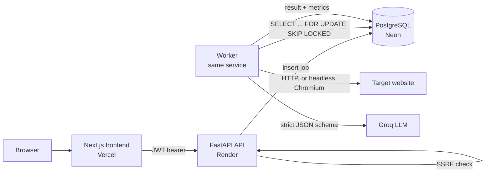

# Smart Web Scraper

Turn any webpage into structured JSON. Give it a URL and the fields you want, and it fetches the page (rendering JavaScript when needed), extracts exactly those fields with an LLM, validates them against your schema, and returns clean JSON.

## Problem statement

Design and build a production-grade, hosted full-stack AI web scraper that uses LLM-based extraction to convert any website into structured JSON, secured with SSRF guardrails, rate limiting, and monitoring.

## How it works

1. **Submit** a URL and a schema: the fields you want, each with a type (text, number, whole number, yes/no, list) and an optional hint.
2. **Validate:** the API resolves the hostname and refuses private, loopback, link-local and cloud-metadata addresses before anything is fetched.
3. **Queue:** the job is stored in Postgres with a snapshot of its fields, and the API returns immediately (`202 Accepted`).
4. **Fetch:** a background worker claims the job, fetches the page over plain HTTP, and only launches headless Chromium if the page is a JavaScript shell. Every redirect and every browser sub-request is SSRF-checked again.
5. **Extract:** the cleaned page text and any schema.org JSON-LD go to Groq's `openai/gpt-oss-120b` with a **strict JSON-schema response format**, so the reply has exactly your keys and types. If that model fails, `llama-3.3-70b-versatile` in JSON mode takes over.
6. **Validate and store:** a Pydantic model built from your schema re-checks the output; mismatches are recorded, not hidden. The dashboard polls and shows the result.



## Tech stack

| Layer | Choice |
|---|---|
| Frontend | Next.js 16 (App Router), TypeScript, Tailwind CSS v4 |
| Backend | FastAPI, SQLAlchemy 2.0, Alembic, Pydantic v2 |
| Auth | Argon2id password hashing (pwdlib), JWT access tokens (PyJWT) |
| Job queue | PostgreSQL rows claimed with `FOR UPDATE SKIP LOCKED`, worker runs inside the API process |
| Scraping | httpx2 for plain HTTP, Playwright headless Chromium as fallback, BeautifulSoup + lxml for cleaning |
| LLM | Groq: `openai/gpt-oss-120b` (strict structured outputs), fallback `llama-3.3-70b-versatile` |
| Database | PostgreSQL 16 (Docker locally, Neon in production) |
| Hosting | Vercel (frontend), Render free Docker web service (API + worker) |
| CI | GitHub Actions: migrations + `alembic check`, pytest against Postgres, frontend typecheck, lint, build |

### Why a Postgres queue instead of Redis + Celery

The original design used Redis and Celery. Render's free tier has no background workers, so a separate Celery worker would cost money, and Redis would be another service to host. Postgres can be a reliable queue: `SELECT ... FOR UPDATE SKIP LOCKED` lets any number of workers each take a different job without blocking each other. Jobs survive restarts, crashed workers' jobs are recovered, and temporary failures retry with exponential backoff. The worker can also run on its own with `python -m app.worker` if the app ever outgrows one process.

## Security and guardrails

- **SSRF protection:** only `http`/`https` on standard ports; hostnames are resolved and every address must be public (blocks `127.0.0.1`, `10.x`, `169.254.169.254`, `::1`, IPv4-mapped IPv6 and internal hostnames). Redirects and browser sub-requests are re-checked.
- **Prompt-injection defense:** page content is fenced inside `<page_content>` and the system prompt tells the model to treat it as data only. Output is constrained by a strict JSON schema and re-validated.
- **Auth:** Argon2id hashes, 60-minute JWTs, the server refuses to start in production with the development secret, and login errors don't reveal which emails exist.
- **Audit trail:** logins, failed logins, data changes and blocked URLs are recorded with the client IP, in the same transaction as the change.
- **Ownership:** every schema and job query is scoped to the logged-in user; other users' records return 404.
- **Rate limits:** `JOBS_PER_HOUR` (default 30) and `MAX_ACTIVE_JOBS_PER_USER` (default 5), enforced in Postgres.
- **Resource limits:** 5 MB page cap, HTML-only content types, 15 s fetch timeout, images, fonts and media blocked in the browser, one job at a time per worker.

## Database

Seven tables, created by Alembic migrations in `backend/alembic/versions/`:

| Table | Holds |
|---|---|
| `users` | email (unique), Argon2 hash, active flag |
| `api_keys` | hashed API keys per user (prefix shown, hash stored) |
| `extraction_schemas` | saved field sets per user, versioned, unique name per user |
| `scrape_jobs` | URL, field snapshot, status enum (`queued`, `running`, `succeeded`, `failed`), attempts, retry time |
| `scrape_results` | extracted JSON, validation errors, model, tokens, latency, fetch method; one per job |
| `llm_usage_logs` | every LLM call, including failed and fallback calls: model, mode, tokens, latency, error |
| `audit_logs` | sign-ups, logins, failed logins, schema and job changes, blocked URLs, with user, target and IP |

Deleting a user cascades to everything they own. Deleting a schema keeps its jobs, deleting a job keeps its usage rows, and deleting an account keeps its audit trail; all three use `ON DELETE SET NULL`.

## API

Interactive docs at `/docs` once the API is running.

| Method | Path | Purpose |
|---|---|---|
| `POST` | `/auth/register` | create an account |
| `POST` | `/auth/login` | OAuth2 password form → JWT |
| `GET` | `/auth/me` | current user |
| `GET` `POST` | `/schemas` | list / create saved schemas |
| `GET` `PUT` `DELETE` | `/schemas/{id}` | read / edit (bumps version) / delete |
| `POST` | `/jobs` | queue a job from `schema_id` or inline `fields` (`202`) |
| `GET` | `/jobs` | paginated list, optional `?status=` |
| `GET` `DELETE` | `/jobs/{id}` | job with result / delete |
| `POST` | `/jobs/{id}/retry` | re-queue a failed job |
| `GET` | `/usage` | LLM calls, tokens, latency and fallbacks per model; jobs by status |
| `GET` | `/activity` | the user's audit trail, newest first |
| `GET` | `/health`, `/health/db`, `/health/worker` | liveness, database, worker + queue depth |

## Project structure

```
smart-web-scraper/
├── backend/
│   ├── app/
│   │   ├── api/            auth, schemas, jobs, insights, health routes; deps (DbSession, CurrentUser)
│   │   ├── core/           settings, password hashing + JWT, audit logging
│   │   ├── db/             SQLAlchemy Base, engine, session
│   │   ├── models/         User, APIKey, ExtractionSchema, ScrapeJob, ScrapeResult, LLMUsageLog, AuditLog
│   │   ├── schemas/        Pydantic request/response models
│   │   ├── scraper/        SSRF guard, fetcher (HTTP + Chromium), HTML cleaner
│   │   ├── extraction/     field specs → JSON Schema, Groq client, CLI
│   │   └── worker/         Postgres queue + worker loop
│   ├── alembic/            migrations
│   ├── tests/              94 tests (unit + Postgres-backed)
│   └── Dockerfile
├── frontend/
│   ├── app/                landing, login, register, dashboard, jobs/[id], schemas, activity, status
│   ├── components/         UI kit, app shell, field builder, JSON viewer
│   └── lib/                API client, auth hook, helpers
├── docker-compose.yml      local Postgres
├── render.yaml             Render blueprint
└── .github/workflows/      CI
```

## Running locally

Prerequisites: Docker Desktop, Python 3.12+, Node.js 20+, and a free [Groq API key](https://console.groq.com/keys).

**1. Database** (repo root)

```bash
docker compose up -d postgres
```

**2. Backend** (`backend/`)

```bash
python -m venv .venv
.venv\Scripts\activate             # macOS/Linux: source .venv/bin/activate
pip install -r requirements-dev.txt
playwright install chromium         # headless browser for JavaScript-heavy pages
cp .env.example .env                # then set GROQ_API_KEY in .env
alembic upgrade head
uvicorn app.main:app --reload --port 8000
```

Try the pipeline on one URL without the API: `python -m app.extraction.cli https://books.toscrape.com/catalogue/a-light-in-the-attic_1000/index.html title:string price:number in_stock:boolean`

Run the tests with `pytest` (database tests use a separate `smart_web_scraper_test` database).

**3. Frontend** (`frontend/`)

```bash
npm install
cp .env.example .env.local
npm run dev
```

Open `http://localhost:3000`, create an account, pick an example on the dashboard and press **Extract JSON**.

## Deployment

1. **Database (Neon):** create a free project and copy its connection string.
2. **API (Render):** New → Blueprint → this repo. Render reads `render.yaml`; fill in `DATABASE_URL` (Neon), `GROQ_API_KEY`, and `CORS_ORIGINS` (your Vercel URL). Migrations run on every start.
3. **Frontend (Vercel):** import the repo, set **Root Directory** to `frontend`, add `NEXT_PUBLIC_API_URL` = your Render URL, deploy.

The free Render service sleeps after 15 minutes without traffic; the first request after that takes about a minute.

## Project status

- [x] Problem definition, architecture, database schema
- [x] Landing page and design system
- [x] Backend: auth, schemas, jobs, health checks
- [x] Scraping pipeline: SSRF guard, HTTP + Chromium fetcher, Groq extraction with validation
- [x] Postgres job queue with retries, backoff and crash recovery
- [x] Frontend: auth, dashboard, field builder, live job view, schemas, activity, status
- [x] LLM usage logging and audit trail, with usage and activity views
- [x] Docker, Render blueprint, CI
- [ ] Evaluation set measuring extraction accuracy per field
- [ ] API-key access for scripts (table exists, endpoints to come)

## License

Academic project, built for a Full Stack Development course.
