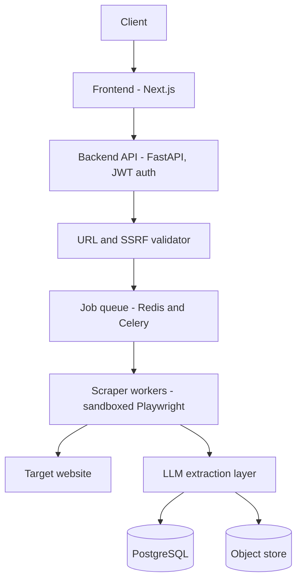

# Smart Web Scraper

Turn any webpage into structured JSON. Give it a URL and the fields you want, and it renders the page, extracts what matters using an LLM, and returns validated JSON.

## Problem statement

Design and build a production-grade, hosted full-stack AI web scraper that uses LLM-based extraction and tool calling to convert any website into structured JSON, secured with SSRF guardrails, rate limiting, and monitoring.

## How it works

1. Submit a URL and a schema, telling Sift what fields you want back.
2. The backend validates the URL and blocks private or internal targets.
3. A sandboxed worker renders the page, including JavaScript-rendered content.
4. An LLM extracts the requested fields, nothing more.
5. Structured JSON comes back, validated against the schema.



## Tech stack

| Layer | Choice |
|---|---|
| Frontend | Next.js, TypeScript, Tailwind CSS |
| Backend | FastAPI |
| Job queue | Redis + Celery |
| Scraper workers | Playwright, sandboxed in Docker |
| Database | PostgreSQL |
| Object storage | Raw HTML snapshots + JSON output |
| LLM | Claude / GPT, with tool calling for multi-step extraction |
| Monitoring | Prometheus + Grafana, Sentry |
| CI/CD | GitHub Actions |

## Project structure

```
smart-web-scraper/
├── frontend/          Next.js app (landing page, schema builder, job dashboard)
│   ├── app/
│   │   ├── layout.tsx
│   │   ├── page.tsx
│   │   └── globals.css
│   └── tailwind.config.ts
├── backend/           FastAPI service (in progress)
├── docs/              Architecture, workflow, and database schema docs
└── README.md
```

## Getting started

Prerequisites: Node.js 18+.

```bash
git clone <your-repo-url>
cd smart-web-scraper/frontend
npm install
npm run dev
```

Visit `http://localhost:3000`.

Backend setup instructions will be added once the FastAPI service is scaffolded.

## Database schema

Full schema (SQL DDL), entity relationships, and API design live in [`docs/smart-web-scraper-workflow-and-schema.md`](./docs/smart-web-scraper-workflow-and-schema.md). Core tables: `users`, `api_keys`, `extraction_schemas`, `scrape_jobs`, `scrape_results`, `llm_usage_logs`, `audit_logs`, `rate_limit_windows`, `target_domain_policies`.

## Security and guardrails

- **SSRF protection** — private IP ranges and internal hosts are resolved and blocked before any request is made.
- **Sandboxed execution** — every scrape runs inside an isolated, short-lived container.
- **Prompt-injection defense** — scraped content is treated as untrusted data, never as instructions to the LLM.
- **Schema validation** — extracted output is checked against the requested schema before being stored or returned.
- **Rate limiting** — per-user and per-target-domain limits, enforced in Redis.

## Project status

- [x] Problem definition and requirement analysis
- [x] System architecture and database schema design
- [x] Landing page
- [ ] Backend API and auth
- [ ] Async job queue and sandboxed scraper workers
- [ ] LLM extraction layer and tool calling
- [ ] CI/CD and hosted deployment
- [ ] Monitoring dashboards

## License

Academic project, built for a Full Stack Development course.